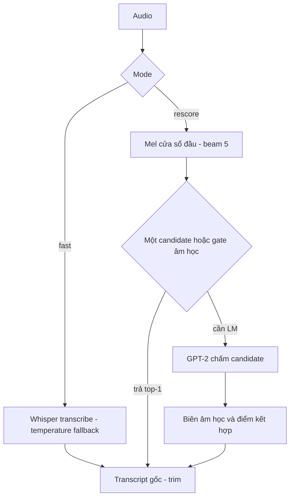

# PhoWhisper-small + GPT-2 — nhận dạng tiếng Việt

Runtime **OpenAI Whisper Python/PyTorch**, checkpoint chính thức
`vinai/PhoWhisper-small` revision `a86b604c346caf7148c37512eafe783a16420adb`.
Không phải C++, faster-whisper hay GGML. Không cần fine-tune để sử dụng.
Small là mặc định từ 2026-11-10 theo quyết định người dùng sau nhận xét định tính
và số đo; không phải tuyên bố gate base/small lịch sử đã đạt.

- **Fast mặc định:** Whisper `transcribe`, giữ temperature fallback, không tải LM.
- **Rescore tùy chọn:** beam 5 + gate âm học + GPT-2 chọn trong N-best;
  không sinh câu sửa mới, không bảo đảm luôn đúng hơn.

> **Audio dài:** public `--rescore`/`rescore=True` chỉ xử lý **30 giây đầu**.
> API/UI không tự chia toàn bộ bản ghi. Fast có luồng Whisper cho audio dài;
> dùng runner phân đoạn bên dưới để so sánh hai mode trên cả bản ghi.

## Cài đặt và model

Core Python >=3.10 theo metadata; benchmark hiện cần >=3.11 (`datetime.UTC`).
Cần FFmpeg trên PATH. Môi trường đã đo: Linux, Python 3.14.8,
torch 2.14.1+cu130, Whisper 20250625, RTX 3050 Laptop 4GB; không phải lock mọi máy.

```bash
git clone https://github.com/apase95/Speech-to-Text-PhoWhisper.git
cd Speech-to-Text-PhoWhisper
python3 -m venv .venv
source .venv/bin/activate
pip install -e .
# Extras tùy nhu cầu:
pip install -e '.[rescore,web,conversion]'
python scripts/convert/convert_phowhisper.py --download \
  --model-id vinai/PhoWhisper-small \
  --revision a86b604c346caf7148c37512eafe783a16420adb \
  --output models/phowhisper-small.pt
```

Converter tải config/weights cùng revision, kiểm tra keys/shapes, ghi provenance;
không ghi đè output không được xác minh. Clone mới không cần activation archive.
Package không chứa weights/data. Default path theo cwd là `models/phowhisper-small.pt`;
override bằng `PHOWHISPER_MODEL_PATH`, restart worker khi đổi model vì loader cache.

## CLI, Python, web

```bash
phowhisper --audio audio.wav
# Rescore trực tiếp chỉ dành cho đoạn <=30 giây:
phowhisper --audio short.wav --rescore
phowhisper --audio short.wav --rescore --beam-size 5 --confidence-threshold -0.020
# Chỉnh tốc độ tùy chọn, không bảo đảm tăng chất lượng:
phowhisper --audio short.wav --time-stretch-rate 0.9
```

```python
from phowhisper.pipeline import transcribe
text = transcribe("audio.wav")
text_rescored = transcribe("short.wav", rescore=True)
```

```bash
PYTHONPATH=src python -m app.web.app
```

Web tại `http://localhost:7860`, dùng WAV theo đường vào đã kiểm tra; checkbox
rescore có cùng giới hạn 30 giây, không tự segment audio dài.

So sánh bản ghi dài trên cùng mảnh **28 giây độc lập** (cần CUDA, checkpoint và
LM pinned đã cache theo [benchmark guide](benchmarks/README.md)):

```bash
PYTHONPATH=.:src python -m benchmarks.runners.compare_personal_small \
  --audio recording.m4a --output-dir outputs/benchmarks/personal-small-new
```

Không giữ ngữ cảnh chéo đoạn. Shared decode/canonicalization, load và warmup
không nằm trong thời gian inference từng mode.

## Số đo small thực tế

### Viet-BUD500: cùng holdout 500 mẫu, 1.300,656 giây audio

| Chỉ số | Small fast public | Small + GPT-2 rescore |
|---|---:|---:|
| WER | 9,4854% | 7,8500% |
| CER | 6,4873% | 5,8158% |
| Exact match sau normalization | 47,8% | 52,0% |
| Inference | 242,563 s | 574,352 s |
| RTF (thấp hơn tốt hơn) | 0,18649 | 0,44159 |
| Median / p95 latency | 0,436 / 0,690 s | 1,158 / 1,526 s |
| Word S / D / I | 271 / 60 / 104 | 195 / 80 / 85 |

Đủ 500/500 mỗi mode, không lỗi. WER giảm 1,6354 điểm phần trăm nhưng deletion
**tăng 60 → 80**. Gate bỏ LM ở 253/500 (50,6%), không suy rộng sang dữ liệu khác.
Bootstrap 2.000 lần, seed 42: 95% CI B−A [-2,6666; -0,6954] điểm phần trăm;
0/2.000 resample không âm không có nghĩa xác suất bằng không. Cohort local này
đã từng đánh giá, không hoàn toàn mới hay bảo đảm không trùng upstream training.

Peak CUDA allocated sau warmup: **1.118.336.512 / 1.635.197.440 bytes**;
reserved: **2.128.609.280 / 2.254.438.400 bytes** (fast/rescore).
Peak allocated khi load: 1.936.234.496 bytes cả hai mode. Đây là allocator
PyTorch, không phải toàn VRAM nvidia-smi. Đã chạy batch 1 trên GPU 4GB;
chưa chứng minh concurrency, CPU throughput hay giảm 70% bộ nhớ so với HF-small.

[Báo cáo, protocol và giới hạn](reports/phowhisper-small-public-modes-vietbud500-20261110.md)
• [JSON curated](configs/evaluations/phowhisper-small-public-modes-vietbud500.json)

### VietMed100 và audio cá nhân

| Tập / mode small | WER | CER | RTF |
|---|---:|---:|---:|
| VietMed all100 fast | 15,8623% | 11,6275% | 0,118819 |
| VietMed all100 rescore | 15,0712% | 11,1571% | 0,300278 |
| VietMed test15 fast | 17,4479% | 12,4456% | — |
| VietMed test15 rescore | 18,4896% | 13,2545% | — |

VietMed là **100 đoạn, khoảng 625 giây, tối đa 8 giây/đoạn**, không phải 100 giờ.
Official checkpoints, không local fine-tune; upstream exposure chưa rõ.
Test15 quá nhỏ để tổng quát và cho thấy rescoring có thể làm xấu kết quả.
[Báo cáo VietMed](reports/vietmed100-base-small-fast-rescoring-20261109.md).

Một clip cá nhân 84,7146875 giây decoded (container 84,714667 giây), chia
28/28/28/0,7146875 giây: fast 3,61945 s (RTF 0,04273), rescore 10,08716 s
(RTF 0,11907). Không reference nên **không WER/CER hay phần trăm độ đúng**.
Nhận xét tích cực của người dùng không thay thế ground truth; không công bố
audio/transcript riêng tư.

## Cơ chế và giới hạn



`score = avg_logprob + 0.200 * LM_logprob_per_token - 0.020 * normalized_word_count`.
Chỉ đổi candidate nếu score tăng và chênh âm học >= -0.20; gate tại -0.020.
Tham số kế thừa base, không retune small. Normalization phục vụ score/metrics,
**không ép harmonization dấu thanh lên transcript trả về**. LM lỗi có thể warning
rồi trả top-1; benchmark nghiêm ngặt chặn fallback đó. PhoBERT là tùy chọn cấp
rescorer, chưa có số đo small mới để quảng bá.

## Tài liệu và lịch sử

- [Usage](docs/usage.md), [kiến trúc](docs/architecture.md), [so sánh](docs/comparison.md)
- [Nâng cấp](docs/upgrade.md), [migration/archive](docs/model-migration-small.md)
- [Đối chứng base/small lịch sử](docs/phowhisper-small-evaluation.md)
- [Benchmark](benchmarks/README.md), [training riêng](training/kaggle/README.md)

Unit tests kiểm tra logic, không chứng minh độ chính xác ASR. Báo cáo base giữ
nguyên model/date/metrics, không relabel thành small.

## Model và giấy phép

[PhoWhisper-small](https://huggingface.co/vinai/PhoWhisper-small): BSD-3-Clause
theo model card. Xem điều khoản riêng của
[GPT-2 Vietnamese](https://huggingface.co/NlpHUST/gpt2-vietnamese) và
[PhoBERT](https://huggingface.co/vinai/phobert-base-v2).
Repo chưa có LICENSE file; không khẳng định mã nguồn được cấp MIT.
