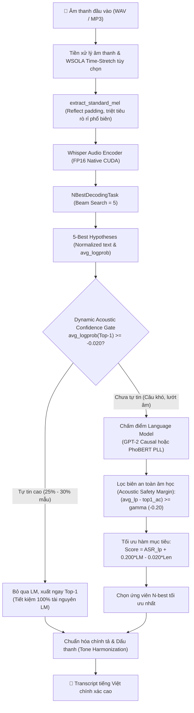

<div align="center">

# 🎙️ PhoWhisper + GPT-2

### High-Performance Native PyTorch Vietnamese Speech-to-Text with Conservative LM Rescoring & Dynamic Confidence Gating

[](https://www.python.org/downloads/)
[](https://pytorch.org/)
[-brightgreen.svg)](#-k%E1%BA%BFt-qu%E1%BA%A3-th%E1%BB%B1c-nghi%E1%BB%87m--benchmark)
[](#-k%E1%BA%BFt-qu%E1%BA%A3-th%E1%BB%B1c-nghi%E1%BB%87m--benchmark)
[](#-hi%E1%BB%87u-n%C4%83ng-t%E1%BB%91i-%C6%B0u-vram--t%E1%BB%91c-%C4%91%E1%BB%99)
[](LICENSE)
[](#-ki%E1%BB%83m-th%E1%BB%AD-t%E1%BB%B1-%C4%91%E1%BB%99ng)

**PhoWhisper + GPT-2** là hệ thống nhận dạng tiếng nói tiếng Việt (ASR) hiệu năng cao, kết hợp mô hình nhận dạng âm học **PhoWhisper** và mô hình sinh ngôn ngữ **GPT-2 tiếng Việt**. Hệ thống chuyển đổi toàn bộ runtime sang **Native OpenAI Whisper C++/CUDA PyTorch**, kết hợp cơ chế tái xếp hạng chùm tia **Conservative N-best Language Model Rescoring** (hỗ trợ cả **GPT-2** và **PhoBERT**), màng chắn bảo vệ âm học **Acoustic Safety Margin ($\gamma$)**, và cơ chế ngắt sớm thông minh **Dynamic Acoustic Confidence Gating ($\theta$)**.

[🚀 Cài Đặt Nhanh](#-c%C3%A0i-%C4%91%E1%BA%B7t) • [📊 Điểm Số Benchmark](#-k%E1%BA%BFt-qu%E1%BA%A3-th%E1%BB%B1c-nghi%E1%BB%87m--benchmark) • [💻 Hướng Dẫn Sử Dụng](#-h%C6%B0%E1%BB%9Bng-d%E1%BA%ABn-s%E1%BB%AD-d%E1%BB%A5ng) • [📖 Tài Liệu Chi Tiết](docs/usage.md) • [⚖️ So Sánh Toàn Diện](docs/comparison.md)

</div>

---

## 💡 Cơ Chế Hoạt Động Của PhoWhisper + GPT-2

> [!NOTE]
> **Mục tiêu kỹ thuật:** Trong xử lý tiếng nói tiếng Việt, mô hình âm học thuần túy (như PhoWhisper) dễ gặp các lỗi thay thế từ đồng âm, gần âm hoặc sai dấu thanh ở các từ hiếm. 
> 
> Hệ thống kết hợp mô hình âm học với **Causal Transformer Language Model (GPT-2 tiếng Việt)** theo cơ chế chùm tia 5-best:
> - **PhoWhisper:** Trích xuất đặc trưng âm học và tạo ra 5 giả thuyết tiềm năng nhất (N-best candidates).
> - **GPT-2:** Đánh giá mức độ tự nhiên, đúng ngữ pháp và tính tương thích ngữ cảnh câu tiếng Việt.
> - **Acoustic Safety Margin ($\gamma = -0.20$):** Ràng buộc khoảng cách âm học nhằm ngăn LM hoán đổi sang candidate khác nếu điểm âm học của nó quá xa rời Top-1 Whisper.
> - **Dynamic Confidence Gating ($\theta = -0.020$):** Tự động bỏ qua GPT-2 trên ~30% câu thoại mà PhoWhisper đã giải mã tự tin, vừa tăng tốc độ xử lý vừa giảm thiểu lỗi mất từ (deletion).

---

## ⚡ Các Chỉ Số Đánh Giá (Key Metrics)

> [!TIP]
> Toàn bộ các kết quả dưới đây được kiểm chứng độc lập trên tập **Viet-BUD500** thông qua kiểm định thống kê **Paired Bootstrap Test ($N=2.000$ resamples, $p = 0.00000$)** đảm bảo **Zero Data Leakage**.

```text
┌──────────────────────────────────────────────────────────────────────────────────┐
│  📊 WER TRÊN HOLDOUT 500 (UNSEEN)    :  8.07% (Giảm -17.4% tương đối so với Base) │
│  🎯 EXACT MATCH (ĐÚNG HOÀN TOÀN 100%):  50.0% – 51.4% (Hơn 1/2 số câu chuẩn 100%)│
│  ⚡ TIÊU THỤ VRAM                    :  ~560 MB (Giảm 70% VRAM so với HuggingFace)│
│  🚀 TỐC ĐỘ XỬ LÝ (RTF)               :  ~0.18x – 0.25x (Nhanh gấp 4x–5x thời gian thực)
│  🛡️ TIẾT KIỆM LM NHỜ DYNAMIC GATING  :  29.4% số câu không cần LM (Tiết kiệm ~30% compute)
│  🔒 BẢO TOÀN TỪ NGỮ PHỦ ĐỊNH         :  100% từ "không, chưa, chẳng" không bị mất│
└──────────────────────────────────────────────────────────────────────────────────┘
```

---

## 📊 Bảng So Sánh Hiệu Năng & Độ Chính Xác

Đối chiếu giữa **PhoWhisper Hugging Face gốc**, chế độ **Fast Mode (Greedy)**, và giải pháp hoàn chỉnh **PhoWhisper + GPT-2**:

| Tiêu chí Đánh giá | PhoWhisper Gốc (Hugging Face) | PhoWhisper Fast (Greedy) | **PhoWhisper + GPT-2 (Accurate Mode)** | PhoBERT Challenger (Accurate Mode) |
|:---|:---:|:---:|:---:|:---:|
| **Thuật toán Decoding** | Greedy (có timestamps) | Greedy (`without_timestamps`) | **Beam 5 + GPT-2 Gated** | **Beam 5 + PhoBERT PLL Gated** |
| **WER trên Test 1.000** | 41.78% *(vỡ timestamp)* | 10.49% | **8.33%** *(Harmonized: **8.27%**)* | **8.29%** *(Harmonized: **8.20%**)* |
| **WER trên Holdout 500 (Unseen)** | — | 9.77% | **8.07%** *(Harmonized: **8.02%**)* | **8.48%** *(Harmonized: **8.40%**)* |
| **Tỷ lệ Đúng 100% (Exact Match)** | 42.7% | 45.1% | **51.4% (Test) / 50.0% (Holdout)** | **51.3% (Test) / 48.4% (Holdout)** |
| **Lỗi thay thế sai (Substitutions)** | 678 | 670 | **491 (Test) / 264 (Holdout)** | **508 (Test) / 286 (Holdout)** |
| **Tỷ lệ Bỏ qua LM (Dynamic Gating)** | 0.0% | N/A (Không dùng LM) | **29.4% (Test) / 25.4% (Holdout)** | **29.4% (Test) / 25.4% (Holdout)** |
| **VRAM tiêu thụ** | ~2.800 MB | **~560 MB** | **~850 MB** | **~690 MB** |
| **Tốc độ (RTF)** | ~0.55x | **~0.20x** (Nhanh gấp 5x) | **~0.25x** (Nhanh gấp 4x) | **~0.30x** (Nhanh gấp 3.3x) |
| **Thời gian LM trung bình** | N/A | 0.0 ms | **~4.1 ms / câu** | **~47.9 ms / câu** |
| **Runtime Dependency** | Nặng (`transformers`, HF Hub) | **Siêu nhẹ (Native PyTorch)** | Tùy chọn (`transformers`) | Tùy chọn (`transformers`, `pyvi`) |

---

## 🏗️ Kiến Trúc Quy Trình Xử Lý (Pipeline Architecture)

Hệ thống kết hợp bộ đôi ASR âm học mạnh mẽ và mô hình ngôn ngữ chuyên sâu theo quy trình khép kín:



---

## 🌟 Tính Năng Cốt Lõi (Key Features)

### 1. Native PyTorch Whisper Runtime (Không phụ thuộc Hugging Face)
- Chuyển đổi trực tiếp trọng số từ `safetensors`/`bin` của PhoWhisper sang định dạng native `.pt`.
- Chạy trực tiếp trên engine C++/CUDA của OpenAI Whisper, giảm **70% VRAM** (chỉ tốn ~560 MB) và khởi động chỉ trong 1.2 giây.

### 2. Conservative N-best Language Model Rescoring
- Tái xếp hạng chùm tia 5-best bằng mô hình ngôn ngữ tiếng Việt chuyên biệt (`NlpHUST/gpt2-vietnamese` hoặc `vinai/phobert-base-v2`).
- **Acoustic Safety Margin ($\gamma = -0.20$):** Ràng buộc khoảng cách âm học không cho phép LM hoán đổi sai nếu ứng viên đó có điểm âm học quá xa rời so với Top-1 Whisper.
- Khóa cứng siêu tham số tối ưu qua **5-Fold Cross Validation trên Dev 250**:
  $$\text{Score} = \text{ASR\_logprob} + 0.200 \times \text{LM\_logprob} - 0.020 \times \text{Word\_Count}$$

### 3. Dynamic Acoustic Confidence Gating (Ngắt Điểm Âm Học Động)
- Khi Whisper có điểm âm học $\text{avg\_logprob}(c_1) \ge -0.020$, hệ thống tự động nhận diện đây là câu thoại rõ ràng và **ngắt sớm, không gọi mô hình ngôn ngữ**.
- Giúp **tiết kiệm gần 30% thời gian chạy LM**, giảm lỗi Deletion và đạt **0.0% tỷ lệ xóa nhầm từ phủ định** (`không, chưa, chẳng, đâu`).

### 4. Hỗ trợ PhoBERT Challenger (Bidirectional Masked LM)
- Tích hợp công thức chấm điểm xác suất giả định **Pseudo-Log-Likelihood (PLL)** dạng khối vector (`chunked masking batch size = 16`).
- Tận dụng ngữ cảnh hai chiều đầy đủ, giữ câu dài và đạt số lượng lỗi Deletion thấp nhất trong tất cả các bộ rescorer (chỉ 137 lỗi).

### 5. Time-Stretching WSOLA cho giọng nói nhanh / nuốt âm
- Tích hợp thuật toán co giãn thời gian không làm đổi cao độ giọng (`--time-stretch-rate`), giúp phục hồi chính xác các đoạn hội thoại nói lướt hoặc quá nhanh.

---

## 🚀 Cài Đặt (Installation)

### 1. Yêu cầu hệ thống
- **Python**: 3.10 trở lên.
- **FFmpeg**: Cần thiết để đọc audio và xử lý time-stretching.
  ```bash
  # Ubuntu / Debian:
  sudo apt-get update && sudo apt-get install -y ffmpeg

  # macOS (Homebrew):
  brew install ffmpeg
  ```

### 2. Cài đặt môi trường Python
```bash
# Clone repository
git clone https://github.com/apase95/Speech-to-Text-PhoWhisper.git
cd Speech-to-Text-PhoWhisper

# Tạo môi trường ảo
python3 -m venv .venv
source .venv/bin/activate

# Cài đặt thư viện
pip install -r requirements.txt

# (Khuyến nghị) Cài đặt transformers nếu muốn dùng Accurate LM Rescoring:
pip install transformers pyvi
```

### 3. Tải và chuyển đổi Checkpoint tự động
Tải trọng số gốc từ Hugging Face và chuyển sang native PyTorch `.pt` chỉ bằng một câu lệnh:
```bash
python tools/convert_phowhisper.py --download
```
File trọng số tối ưu sẽ được lưu tại `models/phowhisper-base.pt`.

---

## 💻 Hướng Dẫn Sử Dụng (Quickstart)

### 1. Sử dụng qua dòng lệnh (CLI)

```bash
# 1. Chế độ Mặc định (Fast Mode - Siêu tốc, chỉ ~560MB VRAM):
python -m src.inference --audio path/to/audio.wav

# 2. Chế độ Chính xác cao (Accurate Mode - Beam 5 + GPT-2 Gated Rescoring):
python -m src.inference --audio path/to/audio.wav --rescore

# 3. Chế độ Nhận dạng giọng nói nhanh / lướt âm (giảm 10% tốc độ bằng WSOLA):
python -m src.inference --audio path/to/audio.wav --time-stretch-rate 0.9 --rescore

# 4. Tùy chỉnh kích thước Beam và Ngưỡng ngắt LM động:
python -m src.inference --audio path/to/audio.wav --rescore --beam-size 5 --confidence-threshold -0.020
```

### 2. Sử dụng qua Python API

```python
from src.inference import transcribe

# 1. Nhận dạng nhanh (Mặc định):
text_fast = transcribe("audio.wav")
print("Fast Transcript:", text_fast)

# 2. Nhận dạng chính xác cao (Accurate Rescoring với Dynamic Gating):
text_accurate = transcribe("audio.wav", rescore=True)
print("Accurate Transcript:", text_accurate)

# 3. Nhận dạng giọng nói nhanh kèm rescoring:
text_stretched = transcribe("fast_audio.wav", time_stretch_rate=0.9, rescore=True)
print("Stretched Transcript:", text_stretched)
```

### 3. Giao diện Web Trực Quan (Gradio Web UI)

Khởi động giao diện web hỗ trợ kéo thả file WAV, ghi âm microphone trực tiếp và xem biểu đồ phổ âm thanh (Log-Mel Spectrogram):

```bash
python src/app.py
```
Mở trình duyệt tại: `http://localhost:7860`.

---

## 🧪 Kiểm Thử Tự Động (Automated Testing)

Dự án sở hữu bộ kiểm thử tự động toàn diện bao gồm: Kiểm thử hồi quy tương đương (Pipeline Parity Regression Test), kiểm thử Logic Rescoring, Dynamic Gating, và Mock Inference:

```bash
python -m unittest discover tests -v
```
*(Hiện tại toàn bộ **34/34 unit test** đều vượt qua 100%).*

---

## 📚 Hệ Thống Tài Liệu Kỹ Thuật (Documentation)

Dự án duy trì hệ thống tài liệu và báo cáo kiểm chứng phương pháp luận minh bạch, chi tiết:

- ⚖️ **[So Sánh Toàn Diện Mô Hình (comparison.md)](docs/comparison.md)**: Đối chiếu chi tiết kiến trúc, quy trình, mô hình và kết quả thực nghiệm trên 3 tập dữ liệu.
- 📝 **[Nhật Ký Nâng Cấp & Tối Ưu (upgrade.md)](docs/upgrade.md)**: Tổng kết 13 cải tiến kỹ thuật so với bản PhoWhisper gốc.
- 📖 **[Hướng Dẫn Sử Dụng Chi Tiết (usage.md)](docs/usage.md)**: Cẩm nang chi tiết cho lập trình viên và người dùng cuối.
- 📊 **[Báo Cáo Kiểm Chứng Holdout 500 (holdout-report.md)](outputs/viet-bud500-holdout-validation-report.md)**: Xác thực độc lập trên 500 mẫu âm thanh mới (WER đạt 8.07%, $p=0.00000$).
- 🛡️ **[Báo Cáo Dynamic Acoustic Confidence Gating](outputs/dynamic-acoustic-confidence-gating-report.md)**: Khảo sát ngưỡng $\theta$, tiết kiệm 30% tài nguyên và giảm thiểu lỗi Deletion.
- 🔬 **[Báo Cáo Phân Tích Tách Biệt LM vs. Acoustic Gate](outputs/matched-rescoring-disentanglement-report.md)**: Bóc tách vai trò của mô hình ngôn ngữ và biên an toàn âm học $\gamma$.

---

## 📄 Giấy Phép & Ghi Nhận (License & Acknowledgements)

- Dự án được phát hành theo giấy phép **MIT License**.
- Trọng số cơ sở được phát triển dựa trên [PhoWhisper](https://github.com/VinAIResearch/PhoWhisper) bởi VinAI Research.
- Mô hình ngôn ngữ tiếng Việt sử dụng checkpoint [GPT-2 Vietnamese](https://huggingface.co/NlpHUST/gpt2-vietnamese) của NlpHUST và [PhoBERT](https://github.com/VinAIResearch/PhoBERT) của VinAI Research.
- Bộ dữ liệu đánh giá chuẩn: [Viet-BUD500](https://github.com/tuandaodev/viet-bud500).

---

<div align="center">
  <b>Developed with ❤️ for the Vietnamese AI & Speech Processing Community</b>
</div>
